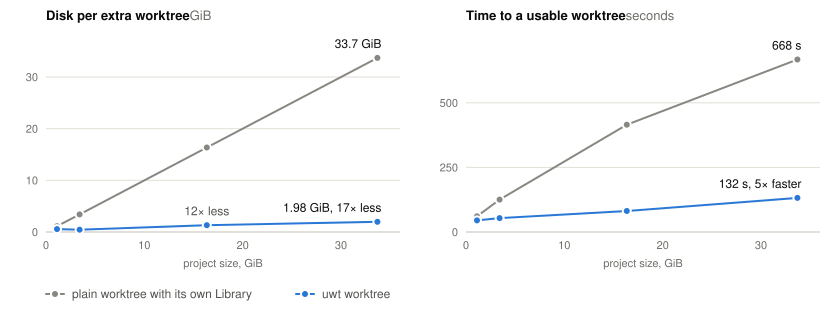

# unity-worktree-cow

An [Agent Skill](https://agentskills.io), unity-worktree-cow (`uwt` for short),
for running many concurrent Unity git worktrees without paying full disk for
each one. It works with any agent that reads `SKILL.md` skills (Claude Code,
Codex, Copilot, Cursor, Gemini CLI, ...), and the script runs fine by hand.

One golden snapshot of the project (working tree + `Library/`) is taken while
the editor is closed. Every new worktree is a block-clone of that snapshot,
which git then reconciles to the requested branch. Each worktree owns a real,
private `Library/`; only the disk blocks are shared, and they diverge on write.
Unity Version Control (Plastic) workspaces work the same way, with `cm` doing
the reconciling; see `SKILL.md`.

<picture>
  <source media="(prefers-color-scheme: dark)" srcset="docs/worktree-cost-dark.svg">
  
</picture>

Four projects on Windows 11 (ReFS) with Unity 6.7: a code-only DOTS project
(1.1 GiB), the URP sample (3.4 GiB), a project in a monorepo subdirectory
(16 GiB) and an asset-heavy one (34 GiB, 41k tracked files). Project size is a
plain checkout plus its own imported `Library/`. The uwt line is `uwt new`, a
first open, then 50 scripted code edits and up to 50 material edits, measured
by physical-cluster overlap (`uwt measure`). `SKILL.md` has the table.

The cost follows the project's file count and code, not its size:

- A fresh worktree is about one 4 KiB cluster per file: 100–344 MiB here, in
  9–29 s.
- The first open adds what Unity regenerates per checkout (`PackageCache`
  binaries, `Bee`, `BurstCache`): 0.3–1.6 GiB.
- Assets and their import results stay shared, so the saving grows with the
  project: 2.0×, 7.6×, 12× and 17× here.

Elsewhere: a production project (41.5k files, 25 GiB `Library/`, Unity 6.6)
with four agent-driven editors compiling and running tests in parallel came to
2.50–2.64 GiB per worktree, against an estimated 31 GiB. On macOS
(APFS) the 34 GiB project is 0 MiB
fresh and 1.45 GiB after a first open and 100 edits (23×); `new` takes about
80 s there, because git re-hashes LFS content once per clone.

A hydrated worktree opens without a reimport (0–6 assets imported, against
4,035–23,451 cold) but not without a compile: the first open rebuilds every
script assembly and resolves packages. That took 36–104 s for one editor alone
on the four projects above, and about 400 s on the production project with
four editors opening at once, most of it contention between them. Seed from a
clean checkout: uncommitted edits in the donor reimport in every worktree.
After the first open a worktree grows slowly, except that on Unity 6.6+ a
texture or model reimport can turn a whole `DataStore` segment private
(0.1–0.5 GiB); see `SKILL.md`.

## Install

`npx skills add Unity-Technologies/unity-worktree-cow` (the `skills` CLI)
installs it for most agents. By hand, copy `skills/unity-worktree-cow/` into
the Unity project's repo, in the folder your agent reads skills from:

| agent | folder in the repo |
|---|---|
| Codex, Cursor, Gemini CLI, GitHub Copilot | `.agents/skills/` |
| Claude Code | `.claude/skills/` |
| Copilot in VS Code | `.github/skills/` |

Commit it either way: `uwt new` resets every worktree to its branch, so an
uncommitted skill does not reach the worktrees it creates.

Cursor and the Copilot coding agent also read `.claude/skills/`, so a repo
used only with those and Claude Code needs just that one. A repo shared with
Codex or Gemini as well needs both folders; keep the full skill in one and, in
the other, a `SKILL.md` that repeats the frontmatter and points at the first, so
there is only one script to update.

An agent without skill support can be pointed at it from `AGENTS.md`:

```markdown
For Unity worktrees, or a worktree whose Library/ needs populating without a
reimport, read .agents/skills/unity-worktree-cow/SKILL.md and use its script.
```

## Use it

In a checkout whose `Library/` is imported and whose editor is **closed**:

```bash
uwt=<skill folder>/scripts/unity-worktree-cow.sh
$uwt doctor                  # proves this volume block-clones; run first
$uwt seed                    # snapshot project + Library into .git/uwt/golden
$uwt new feature/x           # git worktree add + clone + hydrate, ~seconds
$uwt hydrate path/to/wt      # give a worktree someone else created a Library;
                             # safe to re-run, --json for setup scripts
$uwt list --json             # every worktree, and where its Library came from
$uwt remove path/to/wt       # git worktree remove, refused while an editor has it open
                             # (--delete-branch: also the branch, if it holds no work)
$uwt measure                 # private disk of every worktree and the golden
```

`list`, `new`, `remove` and `measure` take `--json` for agents: one record on stdout,
human output on stderr. `new` is safe to run concurrently. `SKILL.md` has a
recipe for one editor per worktree.

One bash script, all platforms. On Windows it runs under Git Bash and uses
robocopy for the clone. Exit codes: `0` ok · `2` failure · `3` refused because
an editor is using the project.

## Requirements

A filesystem that block-clones, with the repo and the worktrees on the same
volume:

- **Windows**: ReFS (Dev Drive) on Windows 11 24H2 or later. NTFS cannot.
- **macOS**: APFS.
- **Linux**: btrfs, XFS with `reflink=1`, or ZFS ≥ 2.2. ext4 cannot.

On anything else `doctor` says so and the tool refuses. There is no copy
fallback: a byte copy of the project is the problem this exists to avoid.

Tested with Unity 6.0, 6.3, 6.6, 6.7 (beta) and 7.0 (alpha), on Windows 11
(ReFS), macOS (APFS) and Linux (btrfs, XFS).

Dependencies are bash, git and coreutils, plus:

- Windows: robocopy and fsutil, both in-box.
- Plastic workspaces: `cm` on `PATH`.
- `measure` only: PowerShell on Windows (in-box) or `python3` elsewhere, to
  read physical extents. It refuses on ZFS, which does not report them.

## Documentation

`skills/unity-worktree-cow/SKILL.md` is the full reference: commands, what
is and is not cloned and why, the cost model, how to measure sharing, and
troubleshooting.

## Tests

```
bash tests/run-tests.sh [ROOT]
```

Synthetic fixtures, no Unity, seconds to run, on Windows (Git Bash), macOS and
Linux. Point `ROOT` at a volume that block-clones to run every group.
